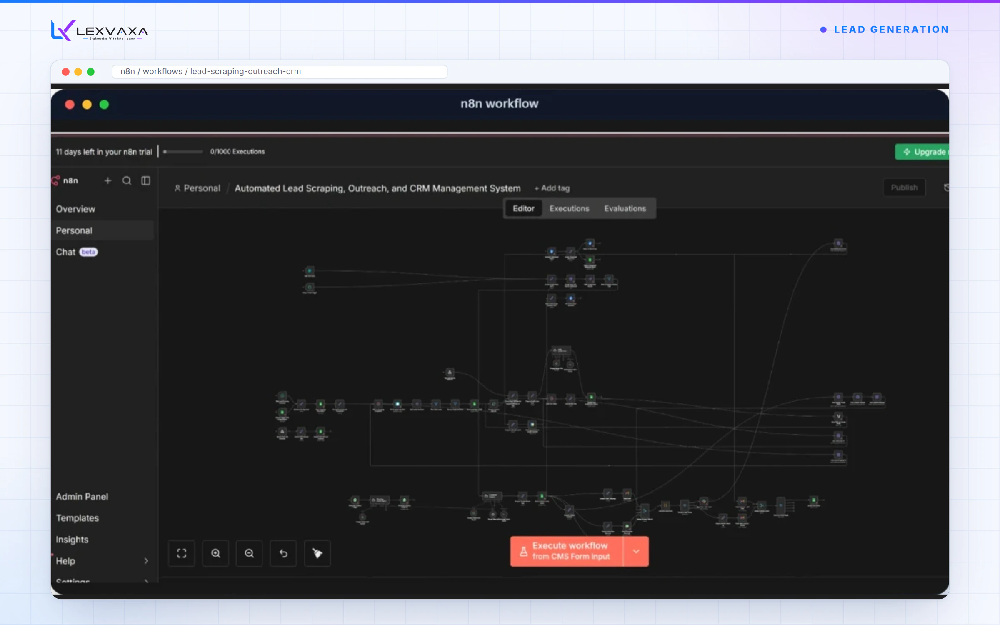
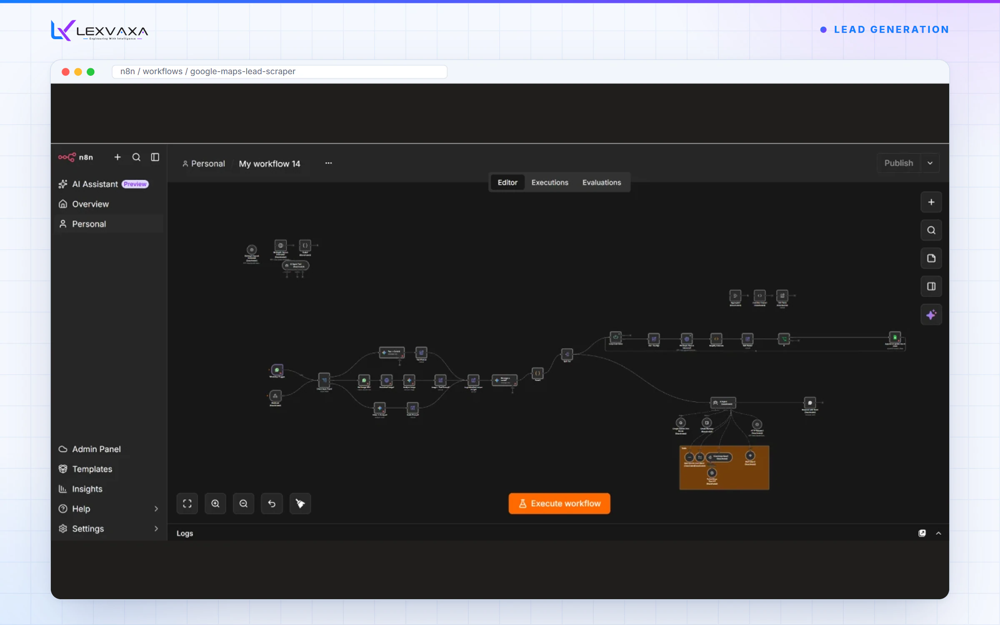

# Google Maps Lead Generation & CRM Automation

**An n8n system that finds businesses on Google Maps, extracts and cleans their contact emails, stores them in a CRM and runs the outreach.**

       

## Overview

Finding, cleaning and following up with leads by hand was slow and left prospect data scattered. Lexvaxa built a lead generation and CRM automation in n8n. It searches Google Maps for target businesses, scrapes their websites for contact emails, filters and removes duplicates, organises everything in Google Sheets or a CRM, and runs cold email outreach with follow-up sequences and response tracking. Screens shown use sample data, so no client records are exposed.

## The challenge

Collecting business contacts from Google Maps and websites by hand was slow, messy and hard to keep organised.

## The solution

n8n workflows for Google Maps searches, URL and email scraping, JavaScript cleaning, deduplication, Google Sheets storage and email sequences.

## Key features

- Google Maps business search
- Website and email scraping
- URL and email filtering
- Duplicate removal
- Leads organised in Google Sheets or a CRM
- Cold email outreach and follow-up sequences
- Response tracking

## Results

- Prospect data stays organised and outreach runs with far less manual work

## Tech stack

n8n · Google Maps · Web scraping · JavaScript · Google Sheets · Email automation

## Screens

## Privacy

Client names and records are confidential. Every screen in this repository uses sample data, and source code that belongs to the client is not published.

## Links

- Case study on Lexvaxa: https://lexvaxa.com/work/google-maps-lead-generation-crm
- Built by **Ch Muhammad Samiullah** ([GitHub](https://github.com/samiullah156-creator)) at [Lexvaxa](https://lexvaxa.com)
